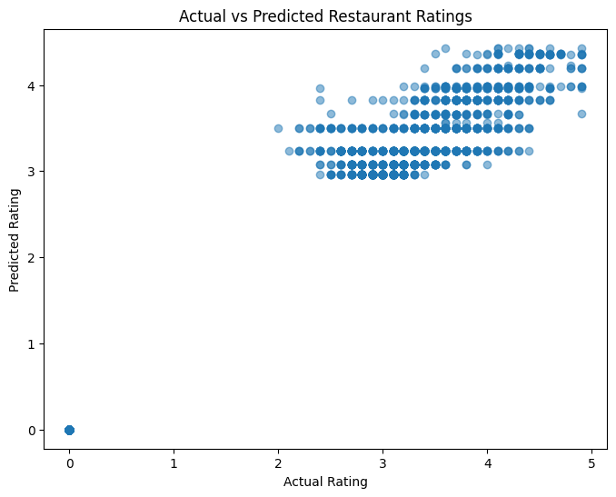

# Cognifyz ML Internship: Restaurant Data Projects

Three machine learning tasks completed for the Cognifyz IT Solutions Machine Learning Internship, all built on one restaurant dataset (`Dataset.csv`: 9,551 restaurants, 21 columns).

| Task | What it does | Key result |
| --- | --- | --- |
| 1. Rating Prediction | Predicts a restaurant's aggregate rating (regression) | Tuned Decision Tree: R² 0.9532, MSE 0.1066 |
| 2. Recommendation System | Content-based restaurant recommender (cuisine, price range, city) | 290-feature representation, 3 validated test cases |
| 3. Cuisine Classification | Predicts a restaurant's primary cuisine (multiclass) | Best accuracy 34.25% (Logistic Regression) |

## Repository contents

```text
├── 01_Task_1_Restaurant_Rating_Prediction.ipynb
├── 02_Task_1_Restaurant_Rating_Prediction_Report.pdf
├── 03_Task_1_Actual_vs_Predicted.png
├── 04_Task_2_Restaurant_Recommendation.ipynb
├── 05_Task_2_Restaurant_Recommendation_Report.pdf
├── 06_Task_3_Cuisine_Classification.ipynb
├── 07_Task_3_Cuisine_Classification_Report.pdf
└── Dataset.csv
```

Each task has a notebook (code and outputs) and a PDF report.

## Task 1: Restaurant Rating Prediction

**Goal:** predict `Aggregate rating` from restaurant features.

**Approach**
- Replaced 9 missing `Cuisines` values with `Unknown`.
- Removed the ID, constant column, and target-leaking columns (`Rating text`, `Rating color`).
- Dropped high-cardinality text fields (name, address, locality, cuisines).
- One-hot encoded Country Code, City, Currency and the Yes/No service fields (165 processed features).
- 80:20 train/test split (`random_state=42`): 7,640 train, 1,911 test. The encoder was fitted on training data only.

**Results (test set)**

| Model | MSE | R² |
| --- | --- | --- |
| Linear Regression | 1.5216 | 0.3315 |
| Decision Tree (unrestricted) | 0.1988 | 0.9127 |
| Decision Tree, max_depth=5 (final) | 0.1066 | 0.9532 |
| Decision Tree, max_depth=10 | 0.1117 | 0.9509 |
| Decision Tree, max_depth=15 | 0.1496 | 0.9343 |

- The unrestricted tree overfit (training R² of about 1.0), so tree depth was limited.
- `Votes` was by far the most important feature, followed by `Longitude` and `Latitude`.



## Task 2: Restaurant Recommendation System

**Goal:** recommend restaurants from user preferences using content-based filtering.

**Approach**
- Split multi-cuisine strings and encoded them with `MultiLabelBinarizer` (146 cuisine features).
- One-hot encoded City (141 features) and mapped Yes/No fields to 1/0.
- Final restaurant representation: 290 features (146 cuisine + 141 city + price + delivery + booking).
- `recommend_restaurants()` filters by cuisine, price range and city, then ranks by aggregate rating with votes as tie-breaker.

**Testing:** three sample preferences were checked programmatically for cuisine, price and city consistency (all True).

| Test | Cuisine | Price | City | Matches |
| --- | --- | --- | --- | --- |
| 1 | Japanese | 3 | Makati City | 2 |
| 2 | Chinese | 1 | Albany | 2 |
| 3 | Indian | 2 | New Delhi | 948 |

## Task 3: Cuisine Classification

**Goal:** predict a restaurant's primary cuisine (first listed cuisine) from its other attributes.

**Approach**
- 119 cuisine classes were reduced to 48 by keeping cuisines with at least 10 restaurants (9,298 restaurants retained).
- Categorical features one-hot encoded, numerical features standardized.
- Stratified 80:20 split: 7,438 train, 1,860 test.

**Results (test set)**

| Model | Accuracy | Weighted precision | Weighted recall |
| --- | --- | --- | --- |
| Logistic Regression | 34.25% | 19.54% | 34.25% |
| Random Forest | 31.61% | 25.99% | 31.61% |
| Decision Tree | 23.82% | 24.37% | 23.82% |

This task is hard with the available fields: classes are heavily imbalanced (North Indian has 2,992 records, several cuisines have one), many cuisines share similar prices, locations and ratings, and many small classes scored near zero. Macro F1 stayed between 0.05 and 0.10.

## Limitations

- **Task 1:** `max_depth` was chosen using test-set performance, so the reported R² is somewhat optimistic. Cross-validation would give a fairer estimate. The actual-vs-predicted plot also shows a cluster of restaurants with rating 0 (unrated), which are included in the data.
- **Task 2:** Online Delivery and Table Booking are accepted as inputs but not used as filters. The function returns all matches rather than a fixed top-N.
- **Task 3:** using only the first cuisine as the label is a modelling assumption, and rare cuisines were removed.

## Run locally

```bash
git clone https://github.com/ashik230509/cognifyz-ml-internship.git
cd cognifyz-ml-internship
pip install pandas numpy scikit-learn matplotlib jupyter
jupyter notebook
```

Open any notebook and run all cells. Keep `Dataset.csv` in the same folder as the notebooks.

## Tech stack

Python, Pandas, NumPy, Scikit-learn, Matplotlib, Jupyter Notebook

## Author

**Ashik T**: B.Tech Information Technology, Nandha College of Technology
GitHub: [@ashik230509](https://github.com/ashik230509)